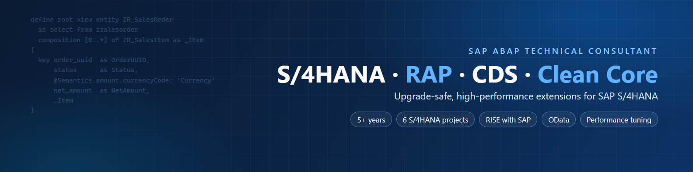

  

  <h1>Hi, I'm Quan 👋</h1>
  
<b>SAP ABAP Technical Consultant</b> · S/4HANA · RAP · CDS · OData · Clean Core

  
  

## 🧭 About me

- 💼 SAP ABAP Technical Consultant at **FPT Software**: **5+ years**, **6 SAP S/4HANA projects** across on-premise, RISE with SAP and private cloud.
- 🏗️ Currently building **Clean Core** extensions (RAP business objects, CDS models, OData services for **Fiori Elements** apps, on released APIs) for a global electronics manufacturer, working offshore with a Korean team.
- ⚡ I like making slow ABAP fast: typically reports from *hours to minutes*, or from *tens of minutes to under a minute*.
- 🖥️ SAP Fiori: Fiori Elements on RAP services (UI annotations), plus **freestyle SAPUI5** apps.
- 🧩 Classic ABAP too: OOP, BAPI/BAdI, exits & Enhancement Framework, ALV, Smart/Adobe Forms, RFC/IDoc/PI-PO integrations.
- 🎓 Computer Science, Ho Chi Minh City University of Technology (HCMUT).
- 🌱 Learning now: ABAP Cloud certification and BTP side-by-side extensions; growing toward a Technical Lead role.

## 🛠️ Tech stack

**SAP**

**Tools & other languages**

## 🚧 What I'm building here

Public demo projects, written from scratch on a trial ABAP system (no client code or data):

| Repo | What it shows | Status |
|---|---|---|
| `rap-purchase-request` | Managed RAP BO with draft, validations, determinations, actions; Fiori Elements via annotations; ABAP Unit | 🗓️ Planned |
| `cds-analytics-sales` | CDS view stack (interface → consumption), analytical annotations, access control (DCL) | 🗓️ Planned |
| `ui5-freestyle-approvals` | Freestyle SAPUI5 app (MVC, routing, OData V4 model) on top of a RAP service | 🗓️ Planned |
| `abap-perf-playbook` | Before/after performance patterns: SELECT in loop, FOR ALL ENTRIES vs JOIN, CDS pushdown | 🗓️ Planned |

## 📫 Get in touch

The best way to reach me is a LinkedIn message or [email](mailto:quanntd2610@gmail.com). Happy to talk about SAP S/4HANA, RAP and Clean Core.
